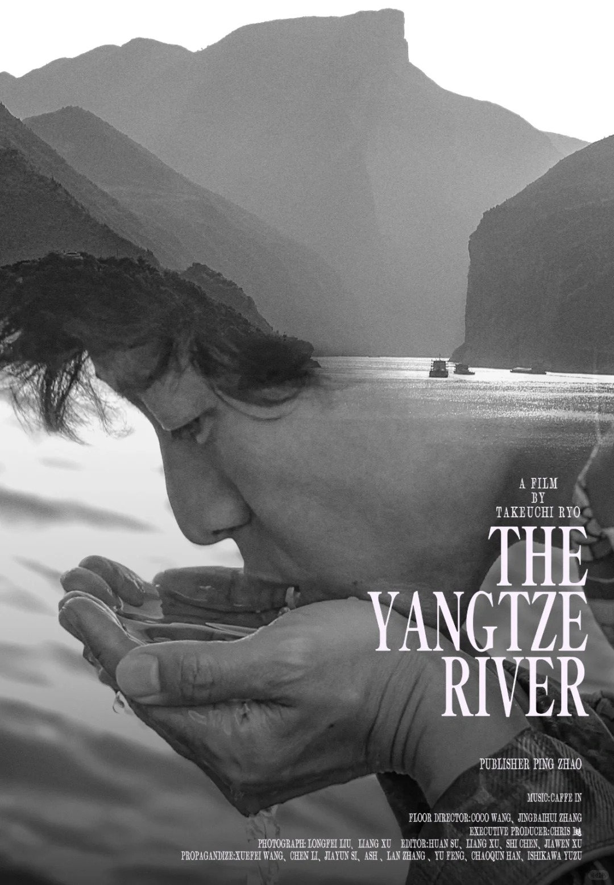

# S01-R03 · 《再会长江》纪录片海报设计飞机稿_1_Vince_来自小红书网页版.jpg

- 原文件名：《再会长江》纪录片海报设计飞机稿_1_Vince_来自小红书网页版.jpg
- 原分类：S01 · 摄影写实
- 初筛建议类：S05 · 拼贴与混合媒介
- 原图尺寸：1080×1556 px
- 缩略图视觉速记：黑白山水与人物面部双重曝光，画面克制，片名采用衬线字。
- 现有初筛状态：仅缩略图初筛，待详细分析
- 现有初筛意见：人物与山水叠合为双重曝光式合成，可作 S05 候选，需原图复核
- 详细视觉分析：尚未建立；此卡只整理图片与现有初筛记录。

这张卡用于按名称、画面速记、分类和初筛意见快速找图。视觉速记来自整组缩略图观察，不替代逐张高清复核；来源标题也不是图面内容或作者授权的证明。实际选作风格参考前，应打开本卡中的原图，确认画面、适用性与近期重复。参考图里的机构、日期、人物和文案不能成为新海报的事实。
