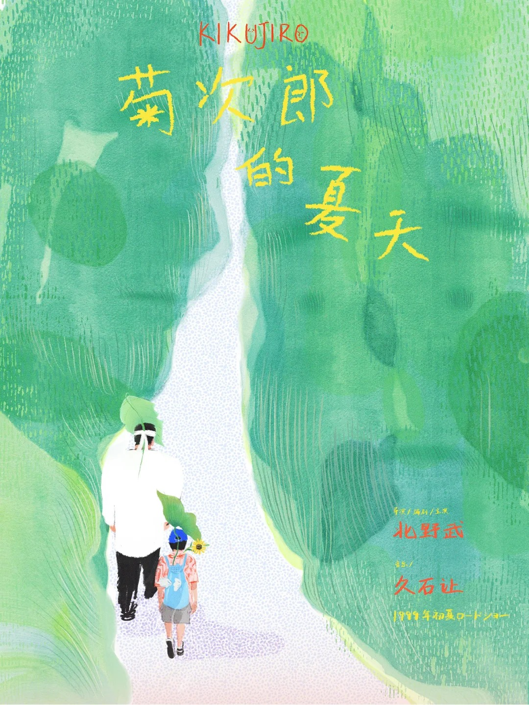

# S02-C02 柔和笔触与自然场景

[返回案例索引](../案例索引.md) ｜ 素材编号：S02-R20 ｜ AI 分析日期：2026-10-03

## A. 图片与来源

| 字段 | 记录 |
| --- | --- |
| 主类 | S02 |
| 主类判断依据 | 绿色树林由层叠笔触构成，浅色道路形成留白，人物以较小比例出现；黄橙手写字带有不规则感。 |
| 辅助标签 | 手绘／柔和／绿色／陪伴 |
| 分析状态 | AI 已分析，待组内复核；未试跑、未做读者测试 |
| 参考用途 | 笔触与氛围参考 |
| 原始文件名 | 菊次郎的夏天☀️_1_momo_来自小红书网页版.jpg |
| 原分类目录 | S02_手绘肌理插画类 |
| 库内图片 | [原图](../images/raw/S02-R20.jpg) |
| 尺寸 | 1080 × 1440 px；仅记录原尺寸，不代表任务输出规格 |
| 来源类型 | 用户收集的外部参考；是否 AI 生成未核实，文件标题不是确证 |
| 文件名中的发布账号线索 | momo；未核实是否为作者 |
| 原作者／原帖 URL／许可 | 均未提供；不能把账号线索当作作者确认 |
| 接收批次 | 2026-10-02；实际下载日期未知 |
| 复核人 | 尚未指定，待组员复核 |

## B. 原案例语境

电影主题插画海报；原作品内容仅为图像语境。

受众与渠道：仅依图面推断其为宣传图，具体投放渠道和实际受众未知。场景库编号尚未建立，此处不新增场景分类。原图品牌、人物、文案、电话、日期、二维码均不进入新任务事实库。

## C. 风格拆解

| 维度 | 观察 | 可执行规则 |
| --- | --- | --- |
| 笔触 | 草木有方向性短线和色层 | 用统一笔触表现自然环境，避免把每片叶子画满 |
| 人物 | 成人与儿童背影建立陪伴关系 | 只表现一般情境，不据此作人物身份或真实服务叙述 |
| 色彩与字体 | 绿底、浅路、黄橙字 | 继承柔和色彩关系，关键字重新建立足够对比 |

未识别具体字体名称和精确色号。描述来自图像观察，不是对制作软件、生成模型或授权情况的判断。

## D. 适用条件与限制

**优先探索条件：** 需要柔和、陪伴、自然气质的短信息方向；长信息需降低场景占比。

**风险：** 片名与署名属于原作品；黄色字在绿色上不保证足够对比；并非完整服务公告。

高信息量时：先减少视觉装饰或主图面积，保留完整批准文案，不将小字塞进背景。多语时重新适配文本长度，不能直接等比例复制中文布局。手机与远距使用均需在目标显示大小或实物尺寸查看。依赖素材需由用户提供或确认可使用；这里的图片只作参考，不能自动转为新海报素材。

## E. AI 可执行风格摘要

> 以柔和层叠笔触表现自然环境，人物简洁、留有空间；用干净文字区承载服务信息，关键数字不使用随意手写字。

调用时同时读取本次需求摘要与事实主表，引用本案例编号，并注明调整。若任务的视觉要求与本例不符，应换候选；不得为贴近参考而更改传播目标。

## F. 与版式库交接

保留安静图像语气，重新建立标题、行动与联系方式区；不保留原电影名称和人物故事。

主题、警示、时间地点的优先级由本次场景与内容分析确定；本卡只提供视觉限制。不能把原图位置、纵横比、栏目数或字数当作全局规则。

## G. 复核与后续试用

- [x] 已打开候选原图观察，并实际读取图片尺寸。
- [x] 已写出与图像对应的风格规则及限制。
- [ ] 组员核查主类、适用建议及来源记录。
- [ ] 用实际社区任务生成小样并核对文字、层级与规格。
- [ ] 在目标阅读条件下记录理解与可读性结果。

试用任务、输出文件、反馈、返工与效果结论：目前均无记录。不能将本卡标记为“已验证有效”。
