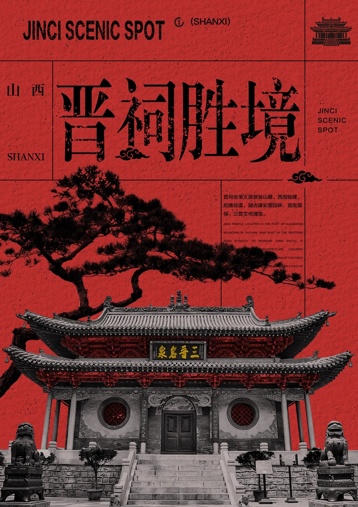

# S02-R19 · 浅模仿一下-建筑海报-晋祠_1_雾隐松山_来自小红书网页版.jpg

- 原文件名：浅模仿一下-建筑海报-晋祠_1_雾隐松山_来自小红书网页版.jpg
- 原分类：S02 · 手绘肌理插画
- 初筛建议类：S01 · 摄影写实
- 原图尺寸：1080×1528 px
- 缩略图视觉速记：红底古建筑黑白摄影，黑色大标题；与 S01-R25 为同一图像。
- 现有初筛状态：重复文件，不计独立案例
- 现有初筛意见：与 S01-R25 文件内容完全一致；建筑摄影处理主导，保留一个索引实体即可；完全重复于 S01-R25
- 详细视觉分析：尚未建立；此卡只整理图片与现有初筛记录。
- 此文件与库中另一张图完全重复，选择时只保留一个。

这张卡用于按名称、画面速记、分类和初筛意见快速找图。视觉速记来自整组缩略图观察，不替代逐张高清复核；来源标题也不是图面内容或作者授权的证明。实际选作风格参考前，应打开本卡中的原图，确认画面、适用性与近期重复。参考图里的机构、日期、人物和文案不能成为新海报的事实。
