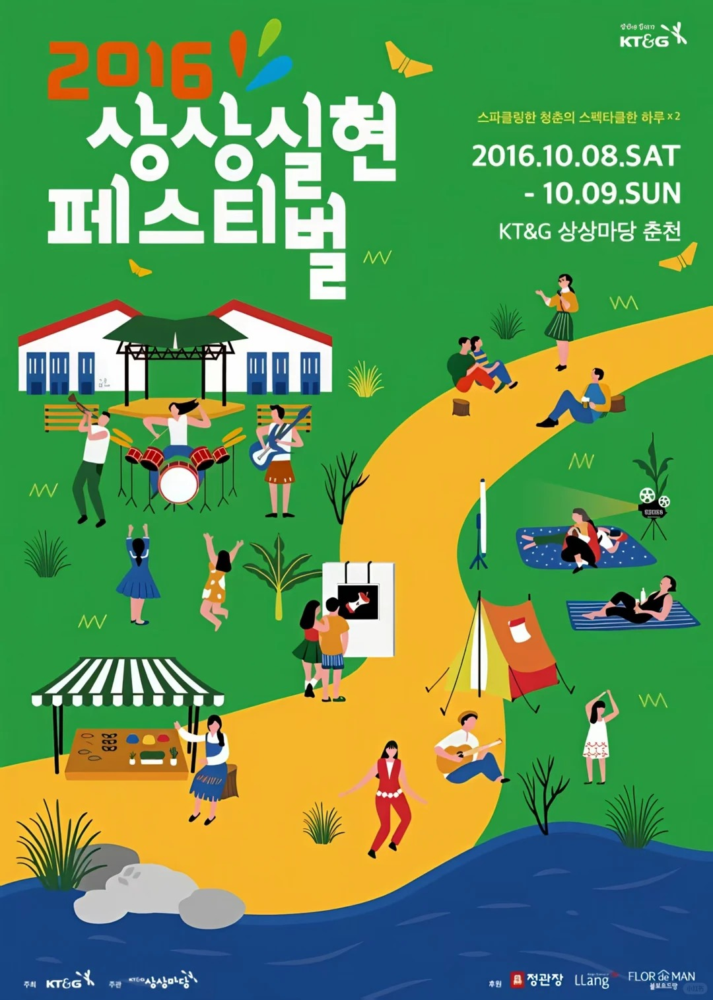

# S03-C01 平面色块与多人物场景

[返回案例索引](../案例索引.md) ｜ 素材编号：S03-R04 ｜ AI 分析日期：2026-10-03

## A. 图片与来源

| 字段 | 记录 |
| --- | --- |
| 主类 | S03 |
| 主类判断依据 | 绿色背景、黄色路径、蓝色水面与简化人物构成场景，较少真实体积阴影，上方留出标题和日期区。 |
| 辅助标签 | 扁平／明快／多人物／色块 |
| 分析状态 | AI 已分析，待组内复核；未试跑、未做读者测试 |
| 参考用途 | 风格与图文分区参考 |
| 原始文件名 | 6张韩国山林活动海报 _ 扁平插画灵感合集_5_小栎果_来自小红书网页版.jpg |
| 原分类目录 | S03_扁平图形插画类 |
| 库内图片 | [原图](../images/raw/S03-R04.jpg) |
| 尺寸 | 1080 × 1514 px；仅记录原尺寸，不代表任务输出规格 |
| 来源类型 | 用户收集的外部参考；是否 AI 生成未核实，文件标题不是确证 |
| 文件名中的发布账号线索 | 小栎果；未核实是否为作者 |
| 原作者／原帖 URL／许可 | 均未提供；不能把账号线索当作作者确认 |
| 接收批次 | 2026-10-02；实际下载日期未知 |
| 复核人 | 尚未指定，待组员复核 |

## B. 原案例语境

韩文活动海报，日期可见但具体语义未作翻译核验。

受众与渠道：仅依图面推断其为宣传图，具体投放渠道和实际受众未知。场景库编号尚未建立，此处不新增场景分类。原图品牌、人物、文案、电话、日期、二维码均不进入新任务事实库。

## C. 风格拆解

| 维度 | 观察 | 可执行规则 |
| --- | --- | --- |
| 形体 | 人物和设施用色块概括 | 减少写实细节，保持动作可辨 |
| 色彩 | 绿黄蓝分出场景层次 | 用有限的功能色组织画面，文字与背景清楚分离 |
| 字体与图形 | 粗白标题与简化环境并置 | 标题字形清晰，装饰仅支持主题 |

未识别具体字体名称和精确色号。描述来自图像观察，不是对制作软件、生成模型或授权情况的判断。

## D. 适用条件与限制

**优先探索条件：** 包含多个可图示行动且希望轻松友好的任务；各行为必须来自本次内容。

**风险：** 人物活动多会分散注意；路径是装饰，不可冒充真实动线；本次未核验韩文含义，仅分析可见结构。

高信息量时：先减少视觉装饰或主图面积，保留完整批准文案，不将小字塞进背景。多语时重新适配文本长度，不能直接等比例复制中文布局。手机与远距使用均需在目标显示大小或实物尺寸查看。依赖素材需由用户提供或确认可使用；这里的图片只作参考，不能自动转为新海报素材。

## E. AI 可执行风格摘要

> 以简化人物、清晰平面色块和统一环境造型表达活动；减少阴影与纹理，留出稳定文字空间，图中动作与批准内容对应。

调用时同时读取本次需求摘要与事实主表，引用本案例编号，并注明调整。若任务的视觉要求与本例不符，应换候选；不得为贴近参考而更改传播目标。

## F. 与版式库交接

若要表现步骤，另用准确编号与说明；不把弯曲路径自动解读为顺序或地图。

主题、警示、时间地点的优先级由本次场景与内容分析确定；本卡只提供视觉限制。不能把原图位置、纵横比、栏目数或字数当作全局规则。

## G. 复核与后续试用

- [x] 已打开候选原图观察，并实际读取图片尺寸。
- [x] 已写出与图像对应的风格规则及限制。
- [ ] 组员核查主类、适用建议及来源记录。
- [ ] 用实际社区任务生成小样并核对文字、层级与规格。
- [ ] 在目标阅读条件下记录理解与可读性结果。

试用任务、输出文件、反馈、返工与效果结论：目前均无记录。不能将本卡标记为“已验证有效”。
