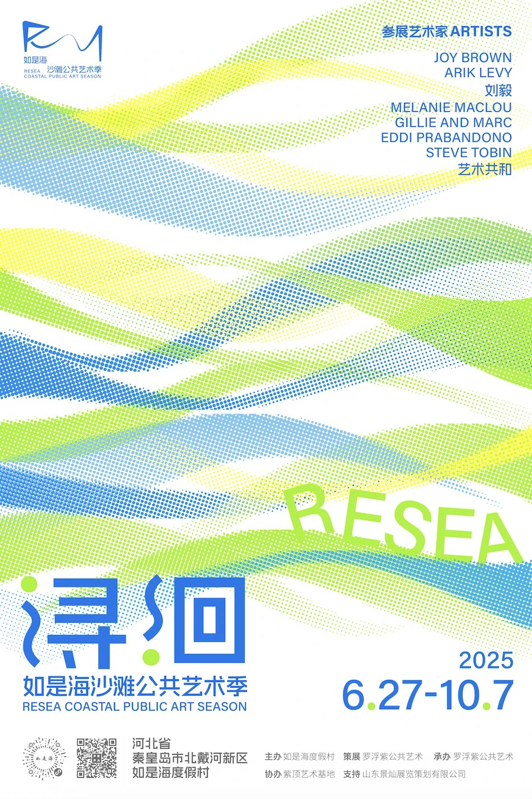

# S03-R21 · 📰设计分享 _ 会展创意海报分享_1_Cooler Design_来自小红书网页版.jpg

- 原文件名：📰设计分享 _ 会展创意海报分享_1_Cooler Design_来自小红书网页版.jpg
- 原分类：S03 · 扁平图形插画
- 初筛建议类：S06 · 字体与抽象图形
- 原图尺寸：948×1422 px
- 缩略图视觉速记：浅底绿蓝波带和细点网纹组成抽象流线，底部留文字区。
- 现有初筛状态：候选原图已查看，AI 分析待组内复核
- 现有初筛意见：已看原图：抽象网点波带主导，无主导人物插画
- 已有详细视觉卡：[S06-C02](S06-C02.md)

这张卡用于按名称、画面速记、分类和初筛意见快速找图。视觉速记来自整组缩略图观察，不替代逐张高清复核；来源标题也不是图面内容或作者授权的证明。实际选作风格参考前，应打开本卡中的原图，确认画面、适用性与近期重复。参考图里的机构、日期、人物和文案不能成为新海报的事实。
