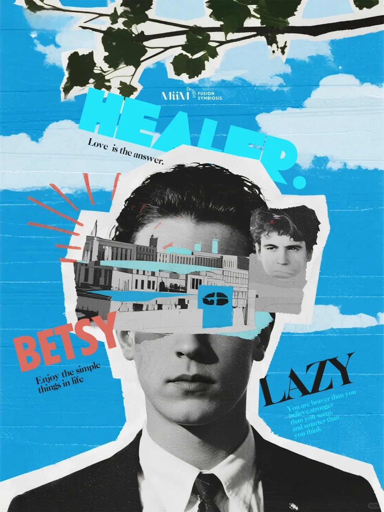

# S05-R04 · 认知的断裂感&拼贴的艺术｜MiiM_1_MiiM_来自小红书网页版.jpg

- 原文件名：认知的断裂感&拼贴的艺术｜MiiM_1_MiiM_来自小红书网页版.jpg
- 原分类：S05 · 拼贴与混合媒介
- 初筛建议类：S05 · 拼贴与混合媒介
- 原图尺寸：1080×1440 px
- 缩略图视觉速记：黑白男性肖像叠上船舶与天空剪片，蓝底橙字形成夏日拼贴。
- 现有初筛状态：候选原图已查看，AI 分析待组内复核
- 现有初筛意见：缩略图初筛：暂保留原分类；正式调用前读取原图和详细分析
- 已有详细视觉卡：[S05-C01](S05-C01.md)

这张卡用于按名称、画面速记、分类和初筛意见快速找图。视觉速记来自整组缩略图观察，不替代逐张高清复核；来源标题也不是图面内容或作者授权的证明。实际选作风格参考前，应打开本卡中的原图，确认画面、适用性与近期重复。参考图里的机构、日期、人物和文案不能成为新海报的事实。
