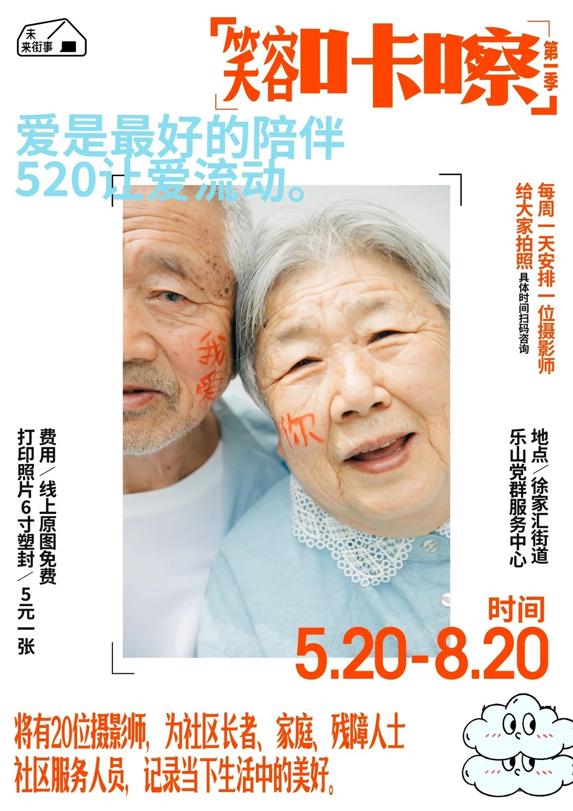
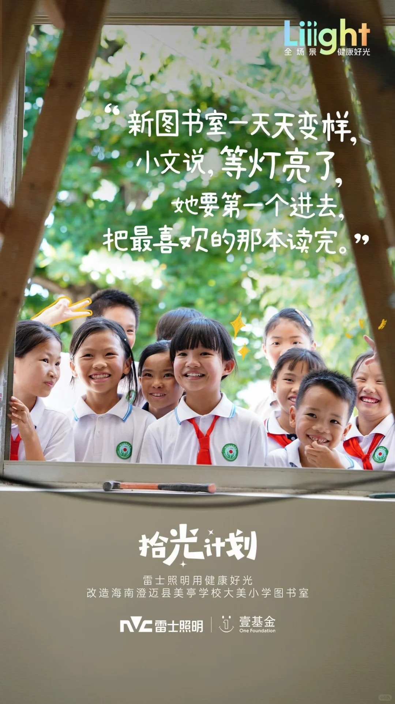
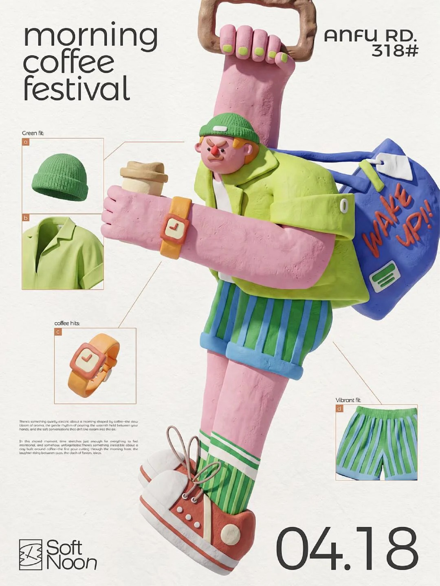

# 社区服务视觉风格案例索引

版本：v1.0 交付版 ｜ 更新：2026-10-03 ｜ 12 张代表案例已分析，待组内复核

本索引由用户实际提供的 97 个素材文件建立；不等于 97 个已分析案例。原图备份、全量初筛与详细案例分层保存。没有原帖链接的案例如实标记未知，不根据文件名虚构作者或授权。

先读[使用说明](使用说明.md)。组员先看[本批素材评审](本批素材评审.md)，需要找其他图片时读[素材全量清单](素材全量清单.md)。新增案例继续使用[案例填写模板](案例填写模板.md)。

## 1. 调用规则

1. 当前卡片状态为“AI 已分析，待组内复核”，可以用于内部试跑候选；不得宣称已通过人工审核或读者测试。
2. 每次只读匹配的 2–3 张卡片并查看原图，不一次载入全部 97 张。
3. “仅视觉技法参考”不提供现成信息结构；需要版式库另外组织完整服务文字。
4. 题材、品牌、人员、地址、日期及二维码只属于原图，禁止带入新任务。
5. 本地库不足时可按需检索，按使用说明记录可访问性、来源与分析；本批没有进行外部网站检索。

## 2. 风格家族总表

| 主类 | 原目录文件数 | 本轮详细案例 | 覆盖与不足 |
| --- | --- | --- | --- |
| S01 摄影写实类 | 29 | [S01-C01](cases/S01-C01.md)、[S01-C02](cases/S01-C02.md) | 人像及纪实两种方法；场所摄影仍为备用候选 |
| S02 手绘肌理插画类 | 24 | [S02-C01](cases/S02-C01.md)、[S02-C02](cases/S02-C02.md) | 版画式与柔和笔触；信息密集手绘通知仍不足 |
| S03 扁平图形插画类 | 23 | [S03-C01](cases/S03-C01.md)、[S03-C02](cases/S03-C02.md) | 多人物平面场景与圆润人物；需检验长行动文案 |
| S04 立体造型与材质类 | 9 | [S04-C01](cases/S04-C01.md)、[S04-C02](cases/S04-C02.md) | 黏土与手工多材质；不能代表全部三维表现 |
| S05 拼贴与混合媒介类 | 5 | [S05-C01](cases/S05-C01.md)、[S05-C02](cases/S05-C02.md) | 撕纸人像与超现实纸感；缺完整公共服务信息案例 |
| S06 字体与抽象图形类 | 7 | [S06-C01](cases/S06-C01.md)、[S06-C02](cases/S06-C02.md) | 书写字形与抽象网点；抽象案例从原 S03 提出重分类 |

## 3. 案例总表

| 编号 | 案例名称 | 标签 | 使用边界 | 原图与分析 |
| --- | --- | --- | --- | --- |
| S01-C01 | 亲近人像与干净底色 | 亲切／人像摄影／橙蓝对比 | 风格与信息关系参考；待组内复核 | [原图](images/raw/S01-R08.jpg) · [案例卡](cases/S01-C01.md) |
| S01-C02 | 自然光纪实与手写叙事 | 纪实／自然光／绿色／手写气质 | 风格参考，信息模板需补全；待组内复核 | [原图](images/raw/S01-R21.jpg) · [案例卡](cases/S01-C02.md) |
| S02-C01 | 限色版画与纸张肌理 | 版画感／纸感／克制／建筑 | 图像表现参考；待组内复核 | [原图](images/raw/S02-R06.jpg) · [案例卡](cases/S02-C01.md) |
| S02-C02 | 柔和笔触与自然场景 | 手绘／柔和／绿色／陪伴 | 笔触与氛围参考；待组内复核 | [原图](images/raw/S02-R20.jpg) · [案例卡](cases/S02-C02.md) |
| S03-C01 | 平面色块与多人物场景 | 扁平／明快／多人物／色块 | 风格与图文分区参考；待组内复核 | [原图](images/raw/S03-R04.jpg) · [案例卡](cases/S03-C01.md) |
| S03-C02 | 圆润人物与花朵色块 | 扁平／圆润／温暖／女性人物 | 造型与配色参考；待组内复核 | [原图](images/raw/S03-R18.jpg) · [案例卡](cases/S03-C02.md) |
| S04-C01 | 黏土人物与材质细节 | 立体／黏土／夸张／触感 | 材质与主体表现参考；待组内复核 | [原图](images/raw/S04-R07.jpg) · [案例卡](cases/S04-C01.md) |
| S04-C02 | 多材质手工造型组合 | 立体／针织／纸折／手工 | 材质对比参考；待组内复核 | [原图](images/raw/S04-R09.jpg) · [案例卡](cases/S04-C02.md) |
| S05-C01 | 撕纸边缘与摄影拼贴 | 拼贴／黑白人像／蓝色／撕纸 | 仅视觉技法参考；待组内复核 | [原图](images/raw/S05-R04.jpg) · [案例卡](cases/S05-C01.md) |
| S05-C02 | 复古纸感与超现实比例 | 拼贴／复古／撕纸／超现实 | 仅视觉技法参考；待组内复核 | [原图](images/raw/S05-R05.jpg) · [案例卡](cases/S05-C02.md) |
| S06-C01 | 书写字形与强色背景 | 字体主导／书写／橙黑／粗笔触 | 字形表现参考；待组内复核 | [原图](images/raw/S06-R01.jpg) · [案例卡](cases/S06-C01.md) |
| S06-C02 | 网点波带与抽象节奏 | 抽象图形／网点／流动／蓝绿 | 抽象图形与信息分离参考；待组内复核 | [原图](images/raw/S03-R21.jpg) · [案例卡](cases/S06-C02.md) |

## 4. 来源与状态管理

图片来自用户收集；文件名中的账号为来源线索，不代表原创作者。原帖链接、许可、实际下载日期均未提供。原始文件名、原类别与尺寸见每张案例卡；全部素材路径和 SHA-256 记录保存在 review/inventory_reviewed.json。

状态顺序：待分析 → AI 已分析待组内复核 → 已分析未实测（组员复核后）→ 已试用（存在具体任务与结果）；不合适时保留为备用或停用，不删除原图。

## 5. 版本记录

v0.3：2026-10-03，收录 97 个文件清单，建立 12 张 AI 分析卡，记录 1 组完全重复；保留 v0.2 空白模板存档。

## 6. 按视觉需求快速查找

本表用于缩小阅读范围，适配结论仍需结合当前事实和原图。这里不建立党政、健康或便民等场景分类。

| 需要比较的视觉方法 | 优先读的案例 | 必要条件或局限 |
| --- | --- | --- |
| 自然人像＋干净底色 | S01-C01 | 有合适且可用的人像；改善竖排和浅字对比 |
| 纪实环境＋情感短句 | S01-C02 | 有实际关联照片；完整行动另设清楚信息区 |
| 限色版画＋纸感 | S02-C01 | 保留肌理而控制文字区干扰 |
| 柔和手绘＋陪伴氛围 | S02-C02 | 不以情绪替代行动；长文案重新组织 |
| 扁平色块＋多行为场景 | S03-C01 | 每个行为来自批准内容；装饰路径不是地图 |
| 圆润人物＋花朵形态 | S03-C02 | 只借鉴造型与配色；不继承受众假设 |
| 黏土体积＋触感细节 | S04-C01 | 立体表现集中于主图，事实文字保持平面清晰 |
| 针织纸折＋材质对比 | S04-C02 | 使用统一光影和有限材质，不让细节争抢信息 |
| 摄影碎片＋撕纸边缘 | S05-C01 | 技法参考，不能直接当完整服务通知模板 |
| 复古纸感＋超现实尺度 | S05-C02 | 技法参考；需重新构建功能文字与适当主体 |
| 书写字形＋强色背景 | S06-C01 | 表现字限于短标题；正文不跟随变形 |
| 网点波带＋抽象节奏 | S06-C02 | 留出清楚文字区，检查缩小后的网点干扰 |

## 7. 逐图浏览与调用摘要

以下图片供人快速浏览。AI 不应仅凭索引文字声称看过原图，应打开实际候选图再分析。每例的观察、来源和复核清单见详细卡；下列适用建议尚未经过实际传播测试。

### S01-C01｜亲近人像与干净底色

[打开详细案例卡](cases/S01-C01.md) · [打开原图](images/raw/S01-R08.jpg) · 原素材：S01-R08

| 查询字段 | 内容 |
| --- | --- |
| 标签 | 亲切／人像摄影／橙蓝对比 |
| 参考范围 | 风格与信息关系参考 |
| 可观察特征 | 老人合影占据主体，皮肤与表情保留摄影质感；白色外围承载橙色标题、时段和黑色说明。 |
| 优先探索条件 | 需要亲切感且有适用人像照片的任务；实际服务对象和照片关系可核实。 |
| 不能直接照搬 | 左右竖排说明增加阅读负担；浅蓝字压在照片上对比不稳定；图上写扫码咨询但当前画面没有明显可用二维码，不能据此复制操作入口。 |
| 交给版式库 | 交接时把费用、地点和咨询方式改为可连续阅读的独立信息区；人像面积服从必需文本。 |
| 当前状态 | AI 已分析，待组内复核；未实测 |

**可执行摘要：** 采用自然人像摄影、干净浅底和克制的暖色强调。保留表情与生活细节，标题有力度，正文不跨复杂面部和浅色照片；按当前任务重新安排事实区。

### S01-C02｜自然光纪实与手写叙事

[打开详细案例卡](cases/S01-C02.md) · [打开原图](images/raw/S01-R21.jpg) · 原素材：S01-R21

| 查询字段 | 内容 |
| --- | --- |
| 标签 | 纪实／自然光／绿色／手写气质 |
| 参考范围 | 风格参考，信息模板需补全 |
| 可观察特征 | 窗边儿童合影、树叶散景和自然光构成主体；上部白色手写引语，下部在较平稳区域放项目名称与标识。 |
| 优先探索条件 | 强调人的体验、项目介绍或服务故事，且有真实素材；受众适配为设计建议。 |
| 不能直接照搬 | 这是叙事宣传，不是完整办事通知；长白字叠在亮散景上可读性不稳定；原图引语与品牌不能带入新任务。 |
| 交给版式库 | 保留纪实气质，另设行动、时间地点和联系方式区；文本增多时减少整幅照片占比。 |
| 当前状态 | AI 已分析，待组内复核；未实测 |

**可执行摘要：** 以自然光人物摄影建立现场感，色调自然不过度滤镜化；情绪短句可手写，关键服务信息使用清晰字形与稳定底色。

### S02-C01｜限色版画与纸张肌理

[打开详细案例卡](cases/S02-C01.md) · [打开原图](images/raw/S02-R06.jpg) · 原素材：S02-R06

| 查询字段 | 内容 |
| --- | --- |
| 标签 | 版画感／纸感／克制／建筑 |
| 参考范围 | 图像表现参考 |
| 可观察特征 | 蓝紫色亭台轮廓、断续刻痕与米色纸纹形成版画感，黄色圆形和少量枝叶作强调。 |
| 优先探索条件 | 需要安静、质朴、文化感的视觉表达；可迁移到相关公共空间介绍，前提是语气符合任务。 |
| 不能直接照搬 | 原图信息少，不能据此证明承载长说明；竖排与低对比小字不可直接复制；题材建筑不等于真实社区服务点。 |
| 交给版式库 | 把艺术性轮廓限制在图像区，办理信息置于干净区域；布局不必沿用竖排。 |
| 当前状态 | AI 已分析，待组内复核；未实测 |

**可执行摘要：** 使用有限色版画质感、概括轮廓与细纸纹，突出主体而非堆积细节；正文保持平实清晰，纹理避开数字、地址和说明。

### S02-C02｜柔和笔触与自然场景

[打开详细案例卡](cases/S02-C02.md) · [打开原图](images/raw/S02-R20.jpg) · 原素材：S02-R20

| 查询字段 | 内容 |
| --- | --- |
| 标签 | 手绘／柔和／绿色／陪伴 |
| 参考范围 | 笔触与氛围参考 |
| 可观察特征 | 绿色树林由层叠笔触构成，浅色道路形成留白，人物以较小比例出现；黄橙手写字带有不规则感。 |
| 优先探索条件 | 需要柔和、陪伴、自然气质的短信息方向；长信息需降低场景占比。 |
| 不能直接照搬 | 片名与署名属于原作品；黄色字在绿色上不保证足够对比；并非完整服务公告。 |
| 交给版式库 | 保留安静图像语气，重新建立标题、行动与联系方式区；不保留原电影名称和人物故事。 |
| 当前状态 | AI 已分析，待组内复核；未实测 |

**可执行摘要：** 以柔和层叠笔触表现自然环境，人物简洁、留有空间；用干净文字区承载服务信息，关键数字不使用随意手写字。

### S03-C01｜平面色块与多人物场景

[打开详细案例卡](cases/S03-C01.md) · [打开原图](images/raw/S03-R04.jpg) · 原素材：S03-R04

| 查询字段 | 内容 |
| --- | --- |
| 标签 | 扁平／明快／多人物／色块 |
| 参考范围 | 风格与图文分区参考 |
| 可观察特征 | 绿色背景、黄色路径、蓝色水面与简化人物构成场景，较少真实体积阴影，上方留出标题和日期区。 |
| 优先探索条件 | 包含多个可图示行动且希望轻松友好的任务；各行为必须来自本次内容。 |
| 不能直接照搬 | 人物活动多会分散注意；路径是装饰，不可冒充真实动线；本次未核验韩文含义，仅分析可见结构。 |
| 交给版式库 | 若要表现步骤，另用准确编号与说明；不把弯曲路径自动解读为顺序或地图。 |
| 当前状态 | AI 已分析，待组内复核；未实测 |

**可执行摘要：** 以简化人物、清晰平面色块和统一环境造型表达活动；减少阴影与纹理，留出稳定文字空间，图中动作与批准内容对应。

### S03-C02｜圆润人物与花朵色块

[打开详细案例卡](cases/S03-C02.md) · [打开原图](images/raw/S03-R18.jpg) · 原素材：S03-R18

| 查询字段 | 内容 |
| --- | --- |
| 标签 | 扁平／圆润／温暖／女性人物 |
| 参考范围 | 造型与配色参考 |
| 可观察特征 | 绿色底上叠加蓝紫花朵、暖色人物和大手造型，黑线勾勒局部细节，体积主要由色块关系而非写实光影形成。 |
| 优先探索条件 | 希望传达关怀、陪伴与轻松气质的任务，且文字量可控。 |
| 不能直接照搬 | 原图几乎没有服务条件和行动流程；巨大手掌和人物隐喻并非所有受众都能理解；不能把女性形象固定绑定全部照护服务。 |
| 交给版式库 | 保留柔和造型，减少花朵或人物数量，为时间地点和行动补足区域。 |
| 当前状态 | AI 已分析，待组内复核；未实测 |

**可执行摘要：** 以圆润扁平人物、少量轮廓线和大色块营造亲近感，保留画面呼吸空间；插画作为辅助理解，不能替代服务文字。

### S04-C01｜黏土人物与材质细节

[打开详细案例卡](cases/S04-C01.md) · [打开原图](images/raw/S04-R07.jpg) · 原素材：S04-R07

| 查询字段 | 内容 |
| --- | --- |
| 标签 | 立体／黏土／夸张／触感 |
| 参考范围 | 材质与主体表现参考 |
| 可观察特征 | 人物四肢夸张，表面可见黏土凹凸，针织帽和衣褶具有体积；白底与小细节框衬托主体。 |
| 优先探索条件 | 需要活力、触感和单主体识别的短信息任务；素材制作能力允许时使用。 |
| 不能直接照搬 | 小字与细节框偏小；人物占比很大不适合直接承载长流程；原图咖啡内容不能转成未经提供的服务。 |
| 交给版式库 | 减少细节放大框，为正式服务信息增加独立区；不要把所有文字立体化。 |
| 当前状态 | AI 已分析，待组内复核；未实测 |

**可执行摘要：** 用统一柔和光照塑造有手工凹凸的立体角色，以干净浅底衬托；正文保持平面高可读性，主体动作和道具只服务本次内容。

### S04-C02｜多材质手工造型组合

[打开详细案例卡](cases/S04-C02.md) · [打开原图](images/raw/S04-R09.jpg) · 原素材：S04-R09

| 查询字段 | 内容 |
| --- | --- |
| 标签 | 立体／针织／纸折／手工 |
| 参考范围 | 材质对比参考 |
| 可观察特征 | 不同角色分别呈现织物、毛线、纸折等材质，统一白色背景；标题也具有柔软立体感。 |
| 优先探索条件 | 需要表现多样、手作、参与感的任务；适用性取决于受众与信息量。 |
| 不能直接照搬 | 当前素材能代表手工材质，不能代表全部三维风格；原图缺少完整办理信息；品牌标识不可复制。 |
| 交给版式库 | 保留若干代表性材质即可，避免为展示材质增加无关角色；正文不叠在纹理上。 |
| 当前状态 | AI 已分析，待组内复核；未实测 |

**可执行摘要：** 用少量互有区别的立体手工材质塑造简洁对象，统一照明和色彩关系；标题可呼应材质，说明信息使用清晰平面文字。

### S05-C01｜撕纸边缘与摄影拼贴

[打开详细案例卡](cases/S05-C01.md) · [打开原图](images/raw/S05-R04.jpg) · 原素材：S05-R04

| 查询字段 | 内容 |
| --- | --- |
| 标签 | 拼贴／黑白人像／蓝色／撕纸 |
| 参考范围 | 仅视觉技法参考 |
| 可观察特征 | 黑白人像、建筑片段、树枝与蓝天通过明显白色撕纸边缘叠合，文字有倾斜和尺度变化。 |
| 优先探索条件 | 需要创意、活力或叙事联想的任务，且用户接受非写实合成。 |
| 不能直接照搬 | 几乎没有完整服务信息；遮挡面部不一定适合公共服务表达；原人物身份、文案与品牌未核实，不复制。 |
| 交给版式库 | 为行动信息保留规整区域，倾斜仅用于装饰短词；不能把电话拆成拼贴字。 |
| 当前状态 | AI 已分析，待组内复核；未实测 |

**可执行摘要：** 将适用图像以有限数量的裁片组合，保留纸边与尺度变化形成节奏；合成不得暗示真实关系，核心服务信息保持连续清晰。

### S05-C02｜复古纸感与超现实比例

[打开详细案例卡](cases/S05-C02.md) · [打开原图](images/raw/S05-R05.jpg) · 原素材：S05-R05

| 查询字段 | 内容 |
| --- | --- |
| 标签 | 拼贴／复古／撕纸／超现实 |
| 参考范围 | 仅视觉技法参考 |
| 可观察特征 | 雕像与塔被组合为不符合现实尺度的托举关系，深蓝底配橙色撕纸和浅圆，局部有网点与刷痕。 |
| 优先探索条件 | 适合探索文化性、象征性图像语言；对一般便民通知适配有条件，需验证理解。 |
| 不能直接照搬 | 原图无标题、日期和行动信息，不能作完整海报模板；宗教雕像语义与公共服务未必相关；不可机械复制题材。 |
| 交给版式库 | 从零建立文字区，必要时只借鉴纸边和配色；禁止把不真实比例用于位置指引。 |
| 当前状态 | AI 已分析，待组内复核；未实测 |

**可执行摘要：** 采用少量裁切图像、旧纸肌理、有限强调色与清楚层次；超现实只承担经确认的象征作用，真实服务事实使用独立信息区。

### S06-C01｜书写字形与强色背景

[打开详细案例卡](cases/S06-C01.md) · [打开原图](images/raw/S06-R01.jpg) · 原素材：S06-R01

| 查询字段 | 内容 |
| --- | --- |
| 标签 | 字体主导／书写／橙黑／粗笔触 |
| 参考范围 | 字形表现参考 |
| 可观察特征 | 白色大型书写字形占据主要视觉识别，橙色背景与黑色山形形成强烈对比，书写断笔与山体肌理呼应。 |
| 优先探索条件 | 需要强主题、文化气质和少量主要文字的方向；长说明需另设承载区域。 |
| 不能直接照搬 | 书写识别门槛较高；原图排布不适合直接转为手机长说明；不能因为有橙色就将其当警示模板。 |
| 交给版式库 | 保留字形气质而非原字，正规标题另核可读性；时间地点使用稳定字体和清楚顺序。 |
| 当前状态 | AI 已分析，待组内复核；未实测 |

**可执行摘要：** 让清晰可认的短标题字形成为视觉主体，以有限色和少量辅助图形建立气质；正文、数字与地址保持标准易读字形。

### S06-C02｜网点波带与抽象节奏

[打开详细案例卡](cases/S06-C02.md) · [打开原图](images/raw/S03-R21.jpg) · 原素材：S03-R21

| 查询字段 | 内容 |
| --- | --- |
| 标签 | 抽象图形／网点／流动／蓝绿 |
| 参考范围 | 抽象图形与信息分离参考 |
| 可观察特征 | 画面以黄绿蓝网点波带构成流动主视觉，没有主导人物或物体插画；底部蓝色标题与日期独立。 |
| 优先探索条件 | 需要开放、流动、现代气质且不依赖具体人物表现的任务；适合构建可延展图形系统。 |
| 不能直接照搬 | 密网点缩放可能干扰阅读或出现摩尔纹；原图参与者名单、日期与二维码不可复制；应检查最终输出。 |
| 交给版式库 | 图形避开事实文字并降低密度；文字量大时收缩波带范围。 |
| 当前状态 | AI 已分析，待组内复核；未实测 |

**可执行摘要：** 用连续线带或半调点阵建立抽象流动感，以白底和少量颜色保留空间；图案不进入关键文字区，导出后检查细纹稳定性。

## 8. 备用素材与新增规则

12 张详细卡是首轮有差异的参考入口，不代表对其他 85 个文件的否定。需要扩大选择时查看[素材全量清单](素材全量清单.md)，打开原图并按[填写模板](案例填写模板.md)补齐分析，再将新案例链接加入总表。分类调整建议集中保留在全量清单中，未逐图确认的结论不自动升级为最终分类。

备用素材中的 S01-R25 与 S02-R19 完全重复；S06 中的劳动者系列存在合集与单张对应，避免把同系列当作多种风格。来源账号、原作者、使用许可必须分开记录。

v1.0（2026-10-03）：定型为“六类总表 → 12 例速查 → 按需查找 → 逐图浏览 → 详细卡”的索引结构。文档交付完成不等于案例效果测试完成。
